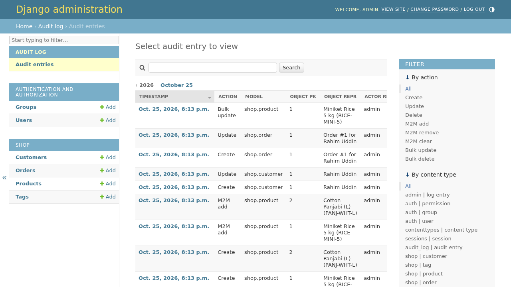
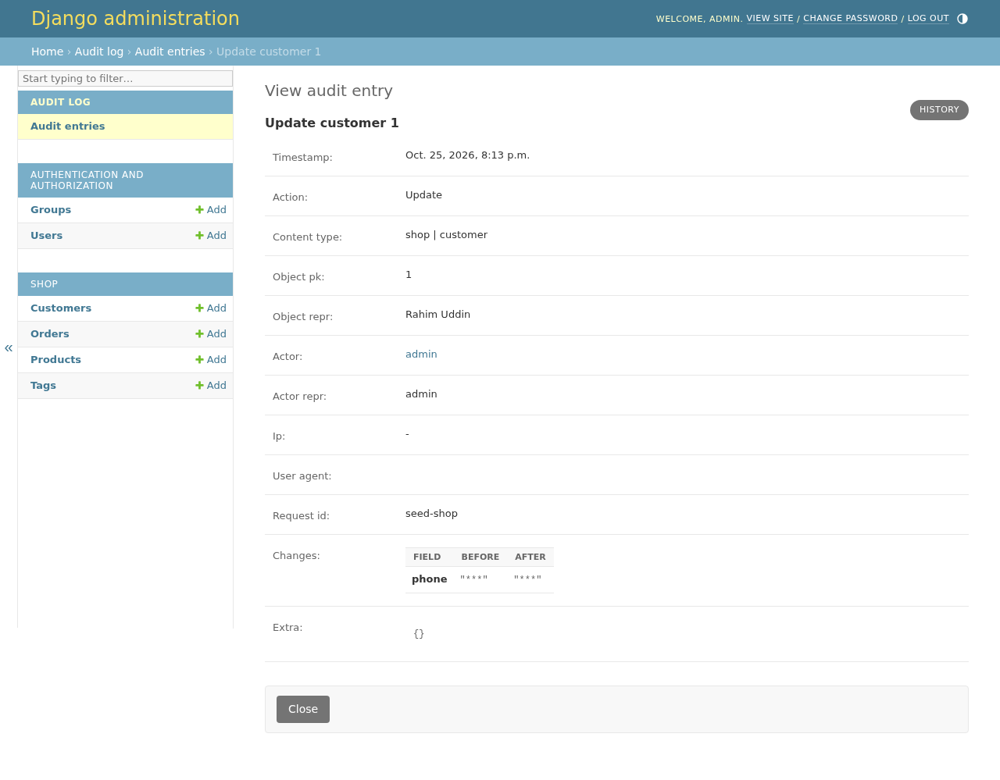
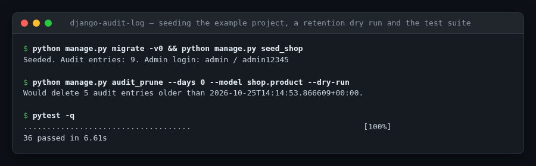
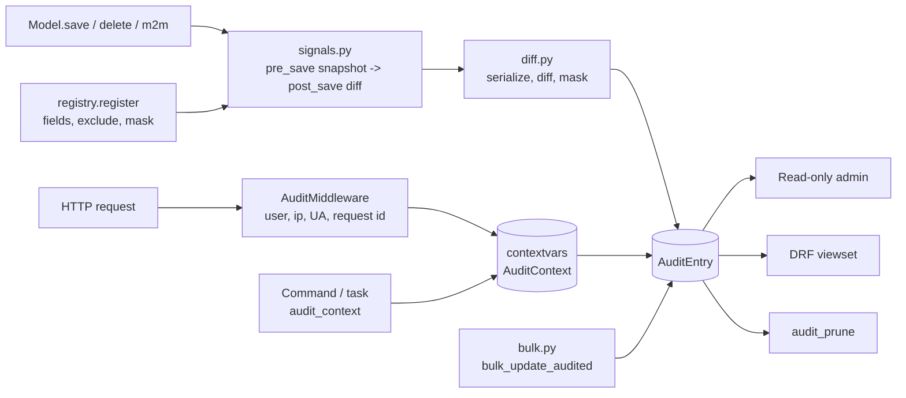

<!-- topics: django,python,audit-log,audit-trail,django-app,compliance,middleware,pypi -->
# django-audit-log

Reusable Django app that records who changed what, when and from where: field-level diffs for create, update, delete and many-to-many changes, masking for sensitive fields, request context (user, IP, user agent, request id) captured by middleware, a read-only admin, an optional DRF endpoint and a retention command.

[](https://github.com/AkibUllah/django-audit-log/actions/workflows/ci.yml)
[](https://github.com/AkibUllah/django-audit-log/actions/workflows/codeql.yml)
[](https://github.com/AkibUllah/django-audit-log/releases)


## Try it live

| | |
|---|---|
| Run in your browser | [](https://codespaces.new/AkibUllah/django-audit-log?quickstart=1) — brings up the example project on Postgres with `docker compose` (migrated and seeded with audited changes); open the forwarded port 8000 and sign in to `/admin/audit_log/auditentry/` with `admin` / `admin12345`. The DRF endpoint is at `/api/audit/` |
| One-click deploy | [](https://render.com/deploy?repo=https://github.com/AkibUllah/django-audit-log) — same example project with a free Postgres, seeded at start-up |
| Local | `docker compose up --build -d` or `make install example-migrate example-seed example-run` (see Quick Start) |

No hosted page: this is a library, and its demo is the example project's admin, which needs a running Django process.

## Screenshots



*The read-only admin of the example project after `seed_shop`: creates, updates, many-to-many adds and a bulk update, filterable by action and content type.*



*An update to a customer's phone number: the change is recorded, the values are masked because `phone` is registered as sensitive.*



*Seeding the example project, an `audit_prune` dry run and the test suite.*

## Why this exists

Every fintech or e-commerce back office I have built eventually gets the same question from compliance: "who changed this customer's phone number, and from which IP?" Bolting `history` tables onto each model one at a time produces inconsistent schemas and leaks NID numbers and phone numbers into logs. This package centralises the answer in one table with one shape, computes the diff at the field level so the entry says exactly what changed, masks fields you declare sensitive, and attaches the request context automatically so the trail is useful to an auditor, not just a developer.

## Features

- `register(Model, fields=..., exclude=..., mask=...)` or the `@audited` class decorator; registration validates field names and connects signals only for registered models
- Field-level JSON diff (`{"price": ["250.00", "299.50"]}`) on create, update and delete; unchanged saves write nothing
- Masking: sensitive fields are recorded as changed but their values are replaced by a configurable marker on both sides
- Many-to-many tracking (`add`, `remove`, `clear`, and `set` as add+remove) with related pks
- `AuditMiddleware` captures the authenticated user, client IP (X-Forwarded-For aware, can be disabled), user agent and a request id (from `X-Request-ID` or generated and echoed back)
- `audit_context(actor=..., request_id=...)` and `disable_auditing()` context managers for management commands, Celery tasks, imports and data migrations; `contextvars`-based so it is safe under threads and async
- `bulk_update_audited()` / `bulk_delete_audited()` for queryset operations that bypass `save()`; one entry per row sharing a `batch_id`
- Read-only admin with action, model and date filters, search and a rendered before/after table
- Optional DRF `AuditEntryViewSet` (admin-only, filter by `model`, `object_pk`, `action`, `actor`, `request_id`)
- `audit_prune --days N | --before DATE [--model app.model] [--dry-run]` with batched deletes
- Queryset helpers `for_object`, `for_model`, `by_actor`, `older_than`; typed (`py.typed`), no dependencies beyond Django

## Architecture



Key decisions:

- **Snapshot in `pre_save`, diff in `post_save`.** The previous row is read once before the write and stashed on the instance; after the write the two snapshots are diffed. This is the only reliable way to know the *old* values without a second table per model.
- **Values are JSON-safe scalars.** Foreign keys are stored as pks, `Decimal` as strings, dates as ISO 8601, files as names. The entry never holds model instances, so pruning or dropping a model never corrupts history.
- **Masking happens in the diff, not in storage.** A masked field shows `["***", "***"]` when it changed and is absent when it did not, so "the phone number was changed by X at Y" is still answerable without the value ever being written.
- **Context, not globals.** `contextvars` carries the actor through the request or task; `disable_auditing()` and nested `audit_context()` restore the previous state on exit.
- **Reverse m2m changes are not attributed.** `tag.books.add(book)` is ignored on purpose: attributing it would require one entry per affected owner and surprise callers. Changes made from the registered model's side are recorded.

## Tech Stack

| Layer | Choice |
| --- | --- |
| Language | Python 3.10+ (typed, `py.typed`) |
| Framework | Django 4.2 and 5.0 |
| Optional | djangorestframework 3.14+ for the read-only API |
| Packaging | hatchling (PEP 621), version 0.1.0 |
| Tooling | pytest + pytest-django (SQLite), ruff, GitHub Actions matrix (Python 3.10/3.11 x Django 4.2/5.0) |

## Quick Start

### Install and configure

```bash
pip install django-audit-log          # or: pip install "django-audit-log[drf]"
```

```python
# settings.py
INSTALLED_APPS = [..., "audit_log"]
MIDDLEWARE = [
    ...,
    "django.contrib.auth.middleware.AuthenticationMiddleware",
    "audit_log.middleware.AuditMiddleware",  # after AuthenticationMiddleware
]
AUDIT_LOG = {  # all optional
    "MASK_VALUE": "***",
    "REQUEST_ID_HEADER": "X-Request-ID",
    "TRUST_X_FORWARDED_FOR": True,
    "STORE_UNCHANGED_UPDATES": False,
}
```

```bash
python manage.py migrate audit_log
```

### Run the example project

```bash
git clone https://github.com/AkibUllah/django-audit-log.git && cd django-audit-log
make install                       # venv + pip install -e ".[dev]"
make example-migrate example-seed  # SQLite, creates admin / admin12345
make example-run                   # http://127.0.0.1:8000/admin/audit_log/auditentry/
```

Or with Docker (Postgres):

```bash
docker compose up --build -d       # migrates and seeds the demo shop on first start (DJANGO_SEED_DEMO=true)
open http://localhost:8000/admin/  # admin / admin12345
```

## Usage

### Register models

```python
# myapp/apps.py
from django.apps import AppConfig


class ShopConfig(AppConfig):
    name = "shop"

    def ready(self):
        import audit_log
        from .models import Customer, Order, Product

        audit_log.register(Product, exclude=["updated_at"])
        audit_log.register(Customer, mask=["nid_number", "phone"])
        audit_log.register(Order, fields=["status", "total_bdt"])  # whitelist
```

or on the model itself:

```python
from audit_log import audited


@audited(exclude=["updated_at"], mask=["phone"])
class Customer(models.Model): ...
```

### What gets written

```python
customer = Customer.objects.create(
    name="Rahim Uddin", nid_number="1990123456789", phone="01711223344"
)
customer.phone = "01999887766"
customer.save()

AuditEntry.objects.for_object(customer).values_list("action", "changes")
# [('update', {'phone': ['***', '***']}),
#  ('create', {'name': [None, 'Rahim Uddin'], 'nid_number': [None, '***'], 'phone': [None, '***']})]
```

### Outside a request

```python
from audit_log import audit_context, disable_auditing

with audit_context(actor=request_user_or_none, request_id="nightly-reprice", source="cron"):
    bulk_update_audited(Product.objects.filter(is_active=True), price_bdt=F("price_bdt") * 1.05)

with disable_auditing():  # fixtures, data migrations, imports
    load_reference_data()
```

### Query the trail

```python
AuditEntry.objects.for_model(Order).filter(action="update", changes__has_key="status")
AuditEntry.objects.by_actor(user).older_than(timezone.now() - timedelta(days=30))
```

DRF (admin-only): `GET /api/audit/?model=shop.order&object_pk=42`, `?action=delete`, `?request_id=abc`.

### Retention

```bash
python manage.py audit_prune --days 365 --dry-run
python manage.py audit_prune --before 2025-01-01 --model shop.product
```

## Project Structure

```
django-audit-log/
├── audit_log/
│   ├── __init__.py        # register / unregister / audited / audit_context / disable_auditing
│   ├── registry.py        # ModelConfig, Registry, signal wiring
│   ├── signals.py         # pre_save snapshot, post_save/post_delete/m2m_changed receivers
│   ├── diff.py            # serialize_value, snapshot, diff, masking
│   ├── context.py         # contextvars AuditContext + context managers
│   ├── middleware.py      # AuditMiddleware (user, ip, UA, request id)
│   ├── models.py          # AuditEntry + queryset helpers
│   ├── admin.py           # read-only admin with before/after table
│   ├── drf.py             # optional serializer + viewset
│   ├── bulk.py            # bulk_update_audited / bulk_delete_audited
│   ├── conf.py            # AUDIT_LOG settings with defaults
│   ├── management/commands/audit_prune.py
│   └── migrations/
├── example/               # runnable project: shop app, seed_shop command, admin, DRF route
├── tests/                 # pytest-django suite with its own settings and testapp
├── Dockerfile · docker-compose.yml · Makefile · .github/workflows/ci.yml
└── pyproject.toml · CHANGELOG.md · requirements*.txt
```

## Testing

```bash
make test        # pytest -q  (36 tests, in-memory SQLite)
make lint
```

Covered: create/update/delete diffs, unchanged saves, `exclude` and `fields` selection, FK serialisation, masking on create and update, registry guards (double registration, unknown fields, unregister, decorator with options), raw fixture loads ignored, m2m add/remove/clear/set and reverse-side behaviour, context managers (nesting, `set_actor`, `disable_auditing`), middleware (user, X-Forwarded-For, request id echo, cleanup, trust toggle), bulk helpers with batch ids, `audit_prune` modes and argument errors, admin permissions and rendering, DRF permissions and filters, queryset helpers.

## Roadmap

- [ ] Async-safe `pre_save` snapshot caching for very hot models (avoid the extra `SELECT`) (#1)
- [ ] Optional `object_repr` templating per model and JSON path filters on `changes` for Postgres (#2)
- [ ] Per-entry retention classes (e.g. keep `delete` entries longer than `update`) (#3)
- [ ] Pluggable sinks (write-through to Kafka / S3 / SIEM alongside the database) (#4)
- [ ] Attribution of reverse-side m2m changes as an opt-in (#5)

## License

MIT - see [LICENSE](LICENSE).
